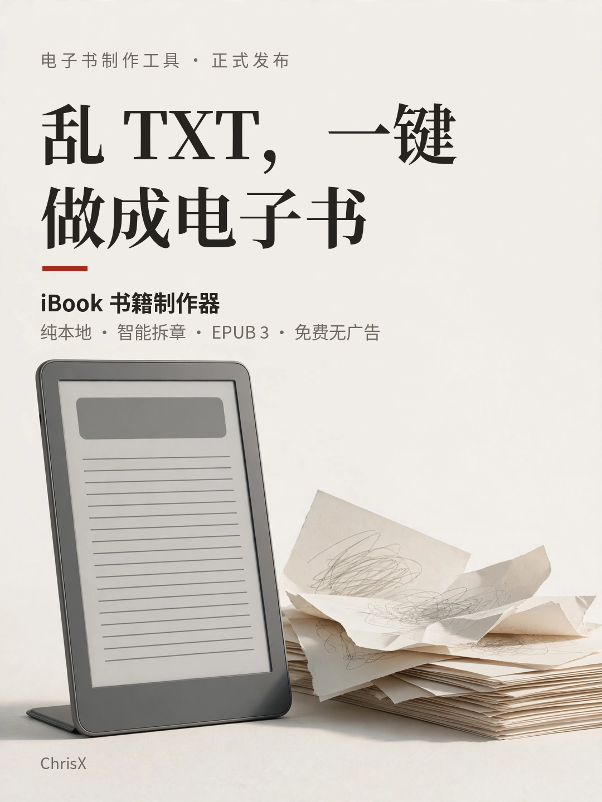

# AI 封面风格库

「AI 封面模式」用的两种底图风格。共同铁律：**底图不带任何文字**——标题、副标题、标签、署名全部由 `scripts/ai_cover.py` 用思源字体叠加渲染（见 SKILL.md「AI 封面模式」一节）。提示词模板可直接复制，替换尖括号里的内容后交给任意生图工具。

## 来源与许可

两种风格的定义与组织方式借鉴自 **[VaneAi888/vane-gpt-image-skills](https://github.com/VaneAi888/vane-gpt-image-skills)**（MIT License）的「小红书图文设计」技能，在此致谢。本文件中的提示词模板为本仓库按自身版式（上半部留白 + 脚本叠字）改写，与原仓库无关的部分（叠字流程、合规要求）为本仓库原创。

## 风格一：极简产品风

**气质**：白底/米白底、大面积留白、画面里只有一个统一主体、柔和自然光与淡影，克制高级，像产品发布会海报。

**适合**：产品发布、软件/工具介绍、AI 工具、数码好物、单个物品的种草。

**构图要点**：主体放在画面下半部（约下 45%），上半部必须是干净的留白给标题；主体居中或略偏左；背景纯色、无杂物、无第二主体抢戏。

**提示词模板**（英文生图效果更稳，附中文版任选其一）：

```
Minimalist product poster photograph, vertical 3:4 composition.
<主体：一句话描述，如 "a sleek e-ink e-reader standing upright on a
clean light surface, screen showing tidy abstract page lines">,
placed in the lower half of the frame against a pure off-white
background, soft natural daylight, gentle soft shadow, generous
empty negative space in the upper half, calm premium tech-product
advertising aesthetic, muted warm tones, photorealistic,
absolutely no text, no letters, no words, no logo, no watermark, no people.
```

```
极简产品海报照片，竖版 3:4。<主体：一句话描述>，主体位于画面下半部，
纯米白色背景，柔和的自然光，淡淡的影子，上半部大面积干净留白，
克制高级的产品广告质感，低饱和暖色调，写实摄影。
画面中绝对不要出现任何文字、字母、标志、水印和人物。
```

**成品示例**（iBook 书籍制作器发布封面，底图 + `ai_cover.py` 叠字）：



## 风格二：手帐拼贴风

**气质**：纸张、照片、便签、胶带、贴纸层层拼贴，手工感、生活气息，像一页摊开的手帐。

**适合**：生活记录、日常分享、兴趣爱好、轻量干货、探店与旅行手记。

**构图要点**：拼贴元素集中在画面下半部和四周边缘，上半部留出一块相对平整的浅色纸面给标题；元素之间留呼吸感，不要满版堆叠；色调统一（同色系纸张与贴纸），避免花哨撞色。

**提示词模板**：

```
Scrapbook collage poster, vertical 3:4 composition. Layered craft
paper, instant photos, sticky notes, washi tape and small stickers
arranged in the lower half and along the edges, all photos and notes
completely blank with no writing on them; the upper half is one
clean flat light-cream paper area kept empty; warm cozy handmade
journal aesthetic, soft daylight, gentle shadows,
absolutely no text, no letters, no handwriting, no words, no logo,
no watermark.
```

```
手帐拼贴风海报，竖版 3:4。牛皮纸、拍立得照片、便利贴、和纸胶带和小贴纸
层层拼贴，集中在画面下半部和四周边缘，照片和便签上完全空白、没有任何字迹；
上半部是一块平整干净的浅奶油色纸面，保持留白。温暖治愈的手作手帐质感，
柔和日光，淡淡的影子。画面中绝对不要出现任何文字、字母、手写字、标志和水印。
```

**注意**：手帐风最容易翻车在「便签/照片上被 AI 写了伪文字」——生成后必须放大检查每一张便签和照片，有任何像字的笔画就换图或重生成，宁可让元素全空白。

## 字体获取（叠字脚本需要）

`scripts/ai_cover.py` 需要三款思源字体（文件太大，不随仓库分发）：

- `NotoSansSC-Regular.otf`、`NotoSansSC-Bold.otf`（黑体：kicker / 标签 / 署名 / 副标题）
- `NotoSerifSC-Bold.otf`（宋体粗：标题）

获取任选其一，放进 `~/.fonts/`（或用 `--font-dir` 指定目录）：

1. GitHub `googlefonts/noto-cjk`：`Sans/OTF/SimplifiedChinese/` 与 `Serif/OTF/SimplifiedChinese/` 下的 `Noto*CJKsc-*.otf`，改名（或软链）为上面的文件名；
2. Google Fonts 下载 Noto Sans SC / Noto Serif SC 字体包后解压；
3. 跑过本仓库 `node scripts/fonts.mjs` 的话，用 `--font-dir` 指向本地化后的字体目录。

找不到字体时脚本会报错并打印同样的获取说明，不会用错字体硬出图。
